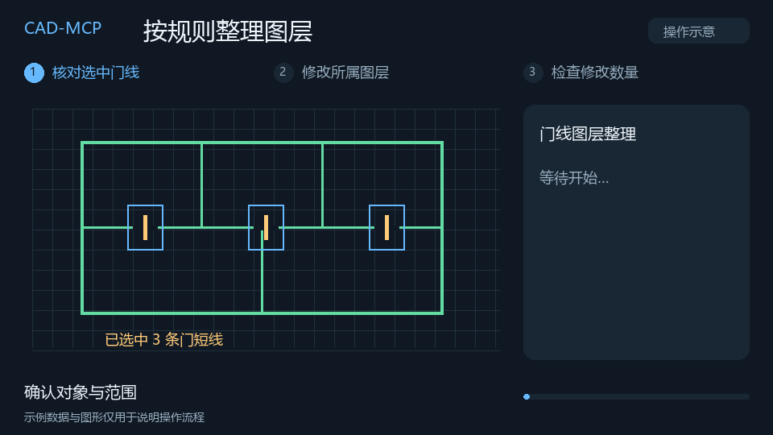
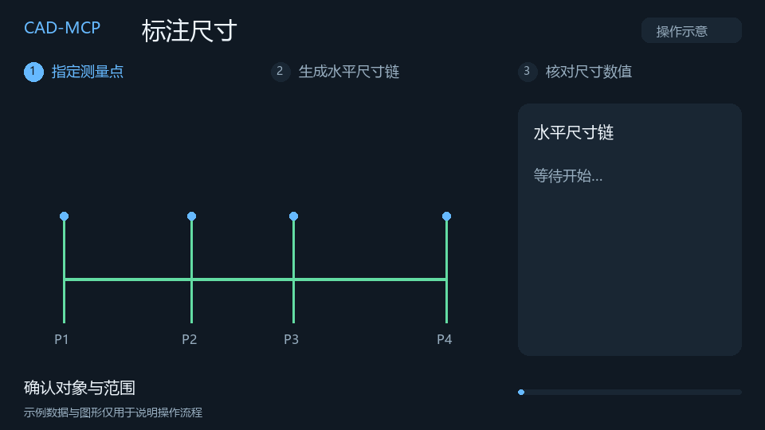

# CAD-MCP

**面向 AutoCAD 2026 建筑二维制图的 AI 工具集。** 通过 MCP（模型上下文协议），让支持 MCP 的 AI 客户端读取当前图纸，并按你的指令调用绘图、编辑、标注和检查工具。

基于 [AutoCAD MCP Pro 1.6.0](https://github.com/U-C4N/Autocad-MCP) 持续维护，重点补充建筑制图能力、中文工具检索和跨主机部署。

当前版本：**1.6.0.post1** · 构建：**portable-20261127.1** · 注册 **239** 项工具，默认启用 **236** 项。

[开发原因](#为什么开发) · [功能介绍](#能做什么) · [适配环境](#适配环境) · [安装使用](#安装与首次使用) · [使用示例](#日常使用示例) · [更新方法](#更新方法)

## 为什么开发

画建筑图时，整理图层、修改门窗、补尺寸、统计房间，往往要花不少时间重复点击和输入命令。CAD-MCP 把这些操作接入 AI 对话，让你用中文说明要改哪张图、哪些对象、采用什么规则，由 AI 调用 AutoCAD 完成操作。

例如，你可以让它把选中的门线归到指定图层，给一组轴线补上尺寸，或检查布局视口的出图比例。处理完成后，还可以查看修改数量和对象属性，核对结果。

项目围绕建筑师每天使用的二维图纸展开，覆盖墙门窗、房间、图层、尺寸和布局等常见工作。希望帮助你减少重复操作，把时间留给方案推敲和图纸完善。

## 能做什么

|能力|典型用途|代表工具|
|---|---|---|
|图纸与实体查询|确认活动图纸、保存状态、图层及实体属性；按区域或类型定位对象|`document_list`、`drawing_info`、`analysis_find_in_region`|
|二维绘制与编辑|绘制基础图元，修剪、延伸、连接曲线及局部拉伸|`curve_trim`、`curve_extend`、`curve_join`、`stretch_window`|
|图层、样式与公司标准|整理实体属性，选用公司图层映射，从已打开图纸导入指定标准|`arch_company_profile`、`arch_profile_config`、`drawing_import_standards`|
|建筑平面辅助|按参数生成墙体网络、门窗洞口、楼梯、轴网及建筑符号|`arch_wall`、`arch_opening`、`arch_stair`、`arch_grid`|
|房间与明细|识别闭合房间、标注名称和面积、输出房间或门窗记录表|`arch_rooms_detect`、`arch_room`、`arch_schedule`|
|尺寸与单位|创建线性、对齐、角度和链式尺寸；核对图纸单位|`dimension_chain`、`dimension_aligned`、`drawing_unit_context`|
|块与属性|插入已有块，读取和修改块属性，使用家具及洁具目录|`block_insert`、`block_set_attributes`、`arch_catalogue_insert`|
|布局与输出|查询视口、设置比例、锁定视口、输出 PDF 或批量打印|`viewport_list`、`viewport_set_scale`、`batch_plot`|
|检查与整理|统计对象，检查重复几何及图纸问题，审计图纸数据库|`analysis_entity_stats`、`drawing_critique`、`drawing_audit`|

这些功能可以配合使用，完成一项包含多个步骤的制图任务。例如整理客房门线时，先结合房间名称和墙线位置确定范围，再调整图层，最后核对数量。遇到房间名称缺失或边界不清的区域，需要你补充判断依据。

完整列表见 [工具目录](latest/docs/工具目录.md) 和 [参数目录](latest/docs/工具目录.json)。执行时应读取当前连接返回的参数与限制。

## 适配环境

|项目|要求与说明|
|---|---|
|日常 DWG 制图|**Windows x64 + 完整版 AutoCAD 2026**，需可正常使用的 AutoCAD 许可|
|CAD 连接方式|COM 连接已打开的 AutoCAD；默认 `AutoCAD.Application.25.1`|
|AI 客户端|支持本地 **STDIO MCP** 的客户端；本项目已在 Codex 中验证|
|安装工具|Git、uv；安装时需要获取 Python 和依赖的网络条件|
|Python|项目声明 3.11 及以上；当前安装验证使用 **3.14**，建议采用下方命令|
|仓库访问|这是私有仓库，克隆账户必须具备访问权限|
|原生模块|安装包附带三个 AutoCAD 2026 DLL，普通使用不需要自行编译|
|可选源码编译|修改 C# 模块时需 .NET 8 SDK 和 AutoCAD 2026 对应程序集|

目前面向 Windows 上的完整版 AutoCAD 2026 提供制图支持。AutoCAD LT、其他年份和其他 CAD 品牌的兼容性尚待验证。

日常 DWG 制图使用 AutoCAD 连接。开发和测试还可选用 `ezdxf` 后端，处理 DXF 文件并运行部分无界面测试。安装流程已在同一台 Windows 电脑的干净克隆和不同用户路径环境中验证，其他电脑上的实际使用情况仍需继续验证。

## 安装与首次使用

### 1. 准备环境和工作目录

安装 Git、uv 和 AutoCAD 2026。在 PowerShell 中确认 `git --version`、`uv --version` 能运行。确保当前 Git 凭据有本私有仓库的读取权限。

准备一个实际使用的本地图纸目录，例如 `D:\CAD_Work`。下文路径只是示例，请替换成自己的**绝对路径**；目录名不能包含逗号。

### 2. 克隆并安装

```powershell
git clone https://github.com/p645763368/CAD-MCP.git
cd CAD-MCP
uv run --no-project --python 3.14 python scripts/install.py --workspace "D:\CAD_Work"
```

安装脚本会：

1. 构建当前仓库代码，并按锁定依赖安装到独立运行环境。
2. 将三个正式 DLL 部署到当前用户的 AutoCAD 插件目录。
3. 检查安装结果，打印命令所在目录和当前主机的 CAD 专用 MCP 配置。

默认运行环境位于 `%LOCALAPPDATA%\CAD-MCP\runtimes\<源码摘要>`，原生模块位于 `%APPDATA%\Autodesk\ApplicationPlugins`。不同代码版本并列安装，避免覆盖正在运行的 Python 环境。

安装器**不会自动修改客户端配置、启动 AutoCAD、调整 CAD 安全设置或修改 PATH**。

### 3. 将配置接入 AI 客户端

将安装结束时打印的 CAD 配置片段合并到客户端的 MCP 配置中，保留其他已有连接。使用脚本生成的绝对 `command` 路径，不要照抄别人的用户名或运行目录。

安装器默认输出 TOML。使用其他客户端时，按该客户端要求映射 `command`、`env` 等字段；仓库提供 [TOML 配置示例](latest/config/autocad-mcp.example.toml)，但其中占位路径不能直接使用。

`--workspace` 会生成 `ALLOWED_PATHS`，指定允许文件操作的目录；它不会自动打开图纸。需要多个项目目录时，可重复传入 `--workspace`。

### 4. 打开 AutoCAD，检查连接

先打开 AutoCAD 2026 和一张准备操作的图纸，再启动或重新加载客户端的 CAD-MCP 连接。向 AI 发送：

> 检查 CAD-MCP 连接，报告版本、活动图纸和保存状态，暂不修改图纸。

当前版本的预期状态：

```text
version:    1.6.0.post1
build:      portable-20261127.1
backend:    com
connected:  true
tool_count: 239
```

默认采用工具搜索模式：客户端可能只直接显示 `search_tools` 和 `call_tool` 两个入口。AI 通过这两个入口查找并调用已启用的具体工具。

首次使用原生功能时，AutoCAD 可能请求加载 DLL。核对名称后按提示处理：`CadMcpNative2026.dll`、`CadMcpArch2026V2Safe.dll`、`CadMcpProjectFix2026.dll`。

### 5. 开始制图

第一次使用建议操作项目副本。指令尽量说明**目标图纸、对象范围、修改规则、单位和是否保存**。操作后要求 AI 读回结果；需要保存时明确说明保存位置。

## 日常使用示例

连接成功后，可以直接在 AI 客户端中发送以下指令。每段动画展示操作步骤和结果，图形与数值采用示例数据。

**先了解图纸**

> 检查当前图纸的单位、图层和模型空间实体数量。列出未保存状态，先不要修改。


**按已知规则整理图层**

> 在当前项目副本中，把我选中的门短线移到 A-SingleDoor 图层。先核对选中对象，修改后报告数量，暂不保存。



**标注尺寸**

> 根据我指定的这些点生成水平尺寸链。先核对图纸实际单位，尺寸文字按毫米显示，完成后读回检查。



**识别房间**

> 在指定墙线范围内识别闭合房间，先报告候选数量和面积，不确定的区域列出来；确认后再写房间名称。


**检查布局**

> 列出当前布局的普通视口和比例，区分纸空间主视口。将指定普通视口设为 1:100 并锁定，保留其他视口。


## 已知限制

- 默认禁用 `drawing_deliver`、`drawing_finalize`、`validation_check` 三个入口。各工具的适用对象和参数要求见工具说明。
- 部分高级建筑生成功能要求毫米模型，调用前需核对图纸单位和该工具的要求。
- 尺寸链采用非关联尺寸，修改原几何后需要重新检查并更新标注。
- 房间识别依赖边界质量。复杂房间、动态块、外参及既有图纸的语义识别存在限制；部分建筑明细依赖工具自身记录。
- 公司使用透明加密软件时，可通过 COM 读取已打开的图纸；导出文件能否在其他程序中打开，需按公司的加密规则单独检查。
- 直接文件操作受允许目录和安全策略限制；当前策略拒绝网络 UNC 路径的直接文件操作。
- 遇到超时，先检查 CAD 中已经完成的操作，再决定下一步，避免重复修改。完成操作后，通过读取几何或属性核对结果。

## 更新方法

在本仓库目录中执行：

```powershell
git pull --ff-only
uv run --no-project --python 3.14 python scripts/install.py --workspace "D:\CAD_Work"
```

把新输出的 `command` 路径更新到 CAD-MCP 连接，再重启该 MCP 连接并核对 `system_status`。如果原生 DLL 有变化且已被 CAD 加载，应先保存自己的工作、关闭 AutoCAD，再安装和启动。

请使用上面的仓库更新流程保留本项目的功能和修复。`uv tool upgrade autocad-mcp-pro` 可能安装同名上游包。仅修改 README 等说明文件不需要重新安装服务。

更多配置、多个工作目录、自定义 DLL 位置、诊断命令及 C# 编译方法见 [部署与更新说明](latest/docs/DEPLOYMENT.md)。

## 常见问题

|现象|处理方法|
|---|---|
|无法克隆私有仓库|确认当前 GitHub 账户被授予仓库权限，并已配置 Git 凭据|
|找不到 `uv`|先安装 uv 并确认其命令可在当前 PowerShell 中运行|
|找不到 `autocad-mcp-doctor` 等命令|安装器不修改 PATH；使用安装输出的命令目录中的完整路径，PowerShell 调用带空格路径时使用 `& "完整路径.exe"`|
|连接失败或活动图纸不对|先打开 AutoCAD，检查客户端启动路径和环境变量，再核对 `document_list`；不要直接在错误图纸上重试写入|
|更新后仍显示旧 build|重新加载 CAD-MCP 连接；仅更新磁盘文件不会替换已运行的进程|
|DLL 无法替换|确认自己的图纸已妥善保存后关闭 AutoCAD，再安装；不要关闭安全加载检查|

## 源码与验证资料

|位置|内容|
|---|---|
|`latest/python/`|维护中的 Python 源码及通用资源|
|`latest/native/`、`latest/native-source/`|三个正式 DLL 及对应 C# 源码|
|`scripts/install.py`|安装与更新脚本|
|`pyproject.toml`、`uv.lock`|包元数据与依赖锁|
|`latest/config/`|通用配置示例和安装依赖约束|
|`latest/docs/`|工具目录、部署说明和验证记录|
|`tests/`|路径、安装和无界面协议测试|
|`latest/metadata/`|上游来源信息；当前维护版本以根目录 `pyproject.toml` 为准|

[跨主机部署验证记录](latest/docs/PORTABILITY-VALIDATION.md)记录了干净克隆、独立安装、11 项测试、STDIO 协议和当前 COM 连接的验证范围。各项测试的环境、结果和待验证范围均在记录中列明。

维护时同步源码、正式运行文件与 GitHub；分别确认磁盘部署和进程实际载入状态。项目图纸、公司项目模板、客户数据、私人配置、备份及测试导出物不提交；通用模板资源可随代码分发。每次测试后恢复原状并核对清理结果。

透明加密环境仅通过已有授权读取获取真实代码，无法读取明文时停止提交，不修改加密服务或权限。普通未加密机器不需要额外配置仓库的内容过滤器。

## 来源与许可

基于 [U-C4N/Autocad-MCP](https://github.com/U-C4N/Autocad-MCP) 维护，保留 MIT 许可及上游声明，详见 [LICENSE](LICENSE) 和 [NOTICE.md](NOTICE.md)。AutoCAD 本身及相关 Autodesk 组件需遵守各自的许可条件。
