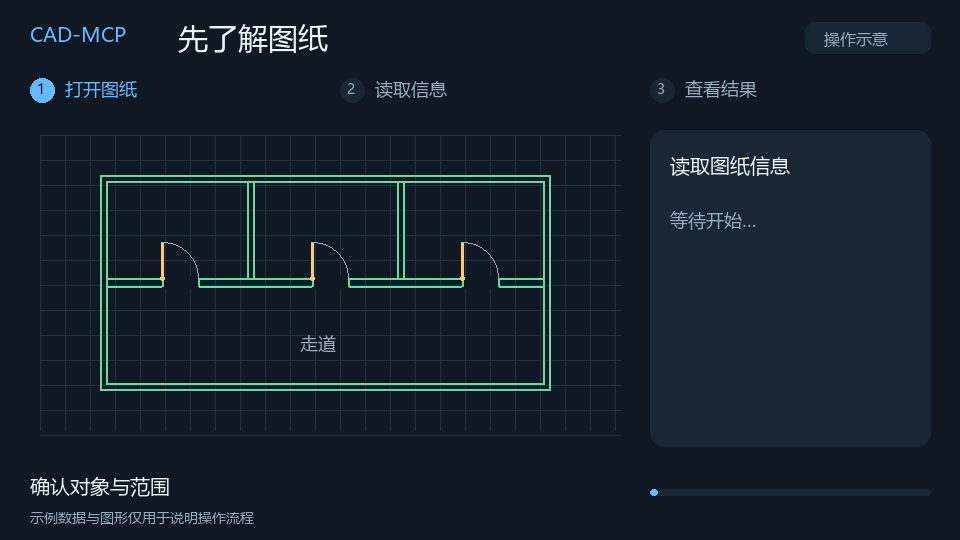
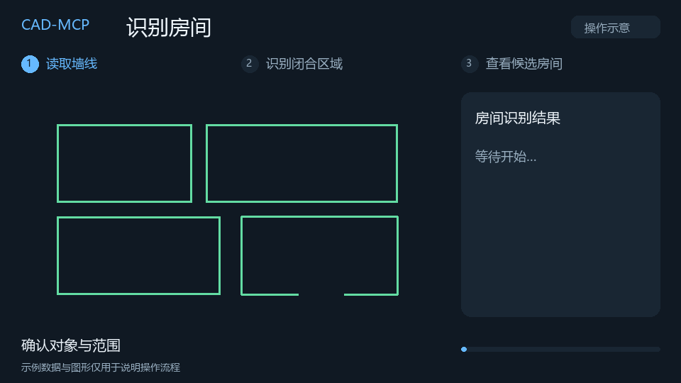
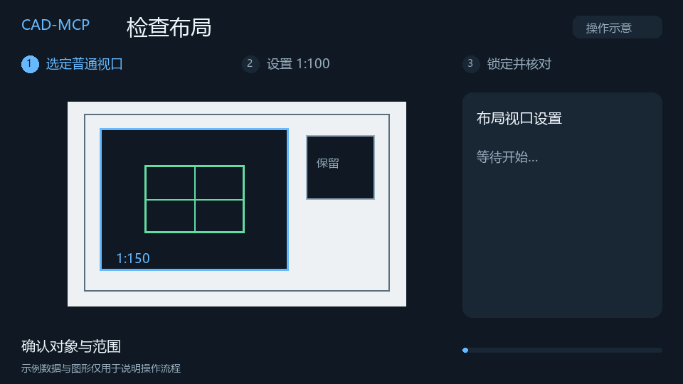
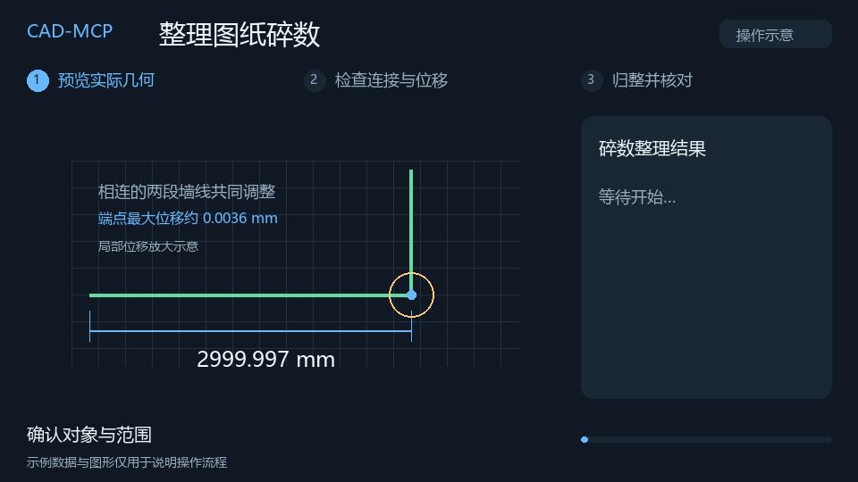
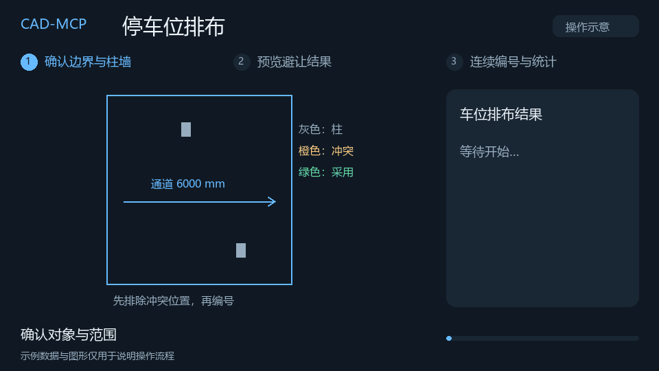
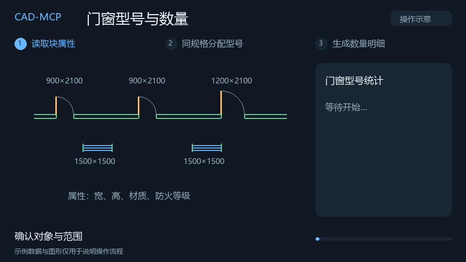

# CAD-MCP

**用中文完成 AutoCAD 日常建筑制图。**

在支持 MCP 的 AI 客户端中说明要处理的图纸、范围和要求，CAD-MCP 就能调用 AutoCAD 完成绘制、修改、标注和检查。适合建筑平面、室内布置、建筑节点及图纸整理中的重复工作。

你可以让它整理门窗图层、生成轴网和轴号、补尺寸、统计闭合房间、整理墙线碎数，排布停车位，或设置布局视口并交付 DWG/PDF。操作过程可在 CAD 顶部查看，也可以随时暂停接入。

当前版本 **1.7.1**。支持 **Windows x64 + 完整版 AutoCAD 2026**。

[功能介绍](#能帮你完成什么) · [全部工具](#全部工具分类清单) · [安装使用](#安装与首次使用) · [使用示例](#日常使用示例) · [适用范围](#使用前了解这些范围) · [更新方法](#更新方法)

## 能帮你完成什么

|工作|可以完成的操作|
|---|---|
|了解现有图纸|读取图层、单位、文字和实体属性，按区域、类型或图层查找对象|
|整理图纸|批量归层、匹配属性、查找替换文字、检查重复几何、清理未使用定义|
|绘制和修改平面|创建基础图元，修剪、延伸、偏移、圆角、倒角及局部拉伸|
|轴网与轴号|生成正交、旋转和弧形轴网；为既有轴线补标、关联已有轴号、批量重编号|
|停车位排布|生成单排、双排、斜列和平行车位，按给定边界与障碍避让，连续编号并统计数量|
|墙、门窗和楼梯|按参数生成二维墙体、门窗洞口和楼梯，添加建筑符号|
|房间与明细|识别房间并标面积；按既有块属性编门窗实例号或型号，更新明细及数量|
|面积汇总|按项目规则合并扣减区、计算计入面积，按面积类型、楼层和分区汇总|
|柱、梁和墙连接|按点位或轴网交点落柱，沿轴线画梁，预览并处理墙角、柱墙和柱梁收口|
|坡道与楼梯检查|按路径和标高画坡道；按给定尺寸限值、梁板底标高及断面检查楼梯和净高|
|尺寸标注|创建线性、对齐、角度、半径和连续尺寸，排列已有尺寸线|
|碎数整理|按网格调整墙线的实际坐标和长度，预览位移并检查接点|
|家具和图块|插入家具、洁具及已有块，读取和修改块属性|
|项目标准|沿用项目图层、文字和尺寸样式，从已打开的模板图导入指定标准|
|布局与出图|设置布局和视口，检查后输出 DWG/PDF及依赖清单；导出中断可从暂存任务恢复|

处理现有项目图时，先指定图纸和对象范围。房间用途、门的分类等信息不明确时，需要结合现有标注或由你补充规则。

## 全部工具分类清单

当前提供 **248 项工具，全部启用**。按下面的工作分类查找即可，无需记住英文名称；直接用中文说明任务，AI 会选择对应工具。

表中介绍主要用途。具体对象范围、单位、默认值和预览要求，以调用前读取的完整工具说明为准；也可查看[完整参数目录](latest/docs/工具目录.json)。

[轴网与停车位](#tool-category-1) · [墙门窗、房间与面积](#tool-category-2) · [柱梁、楼梯与坡道](#tool-category-3) · [了解图纸与测量](#tool-category-4) · [查找、选择与定位](#tool-category-5) · [基础绘制与边界](#tool-category-6) · [几何编辑与图纸整理](#tool-category-7) · [尺寸与注释比例](#tool-category-8) · [文字、表格与建筑符号](#tool-category-9) · [图层与项目标准](#tool-category-10) · [图块、家具与部品清单](#tool-category-11) · [填充、外参和底图](#tool-category-12) · [布局、视口与图框](#tool-category-13) · [文件、保存与交付](#tool-category-14) · [视图与坐标系](#tool-category-15) · [连接、设置与执行控制](#tool-category-16)

<a id="tool-category-1"></a>

### 轴网与停车位

共 5 项。

|工具|用途说明|
|---|---|
|`arch_grid`|生成正交、斜向及弧形轴网和轴号。|
|`grid_label`|为既有直线或弧轴补轴号并刷新位置。|
|`grid_renumber`|批量修改已记录轴号并检查重号。|
|`parking_row`|在通道一侧或两侧排布车位，按边界及障碍筛选后连续编号。|
|`parking_layout`|按指定停车行方案排布、避让和统计；不搜索全场最优方案。|

<a id="tool-category-2"></a>

### 墙门窗、房间与面积

共 10 项。

|工具|用途说明|
|---|---|
|`arch_wall`|按轴线和厚度建立并更新墙体网络。|
|`arch_opening`|在已记录墙体上生成门窗洞口。|
|`arch_plan_from_spec`|按规格生成墙门窗楼梯及标注平面。|
|`arch_room`|在指定房间内写入用户给定的名称和面积。|
|`arch_rooms_detect`|只读识别直线墙体围合的房间候选及面积；不自动判断用途或写名称。|
|`arch_schedule`|将CAD-MCP墙洞口或房间记录生成明细表。|
|`door_window_tag`|按指定门窗块属性分配实例编号或同规格型号。|
|`schedule_update`|读取已关联门窗块，生成或更新型号数量表；表格重建时句柄可能变化。|
|`area_schedule`|按项目规则计算面积、扣减并按楼层分区汇总。|
|`arch_units_migrate`|明确旧记录原单位后转换建筑记录数值；不缩放原图形。|

<a id="tool-category-3"></a>

### 柱梁、楼梯与坡道

共 6 项。

|工具|用途说明|
|---|---|
|`column_place`|按点位或直轴交点布置圆柱和矩形柱。|
|`beam_place`|沿直轴绘制梁平面边界并记录宽度。|
|`wall_join`|预览并处理墙面角点或柱墙收口。|
|`arch_stair`|按踏步和层高参数绘制平面楼梯。|
|`ramp_draw`|按路径和标高绘制坡道平面及坡度标注。|
|`stair_check`|按输入尺寸、剖面和梁板底标高检查踏步与净高；不自动读取图中楼梯。|

<a id="tool-category-4"></a>

### 了解图纸与测量

共 19 项。

|工具|用途说明|
|---|---|
|`drawing_info`|读取当前图纸名称、路径、单位及对象数量。|
|`drawing_understand`|分析已打开图纸的单位、图层、文字及几何分布。|
|`drawing_unit_context`|读取图纸单位并用已知长度校核；不修改图形或INSUNITS。|
|`drawing_diff`|比较两图实体几何变化并可生成修订标记。|
|`drawing_topology_check`|检查管线网络的断头、近接和交叉。|
|`validation_check`|检查零长、重合几何、记录编号和依赖；重合属于警告，须结合返回等级判断。|
|`drawing_preflight`|只读核对建筑任务要求并返回预检结果。|
|`drawing_plan`|记录本次建筑绘图计划和出图要求。|
|`drawing_critique`|按选定规则评审尺寸、重复实体和建筑记录。|
|`analysis_bounding_box`|逐实体计算模型空间的包围盒。|
|`analysis_entity_stats`|按实体类型和图层统计数量。|
|`analysis_layer_stats`|统计各图层的实体数量及类型。|
|`analysis_list_properties`|读取实体可用的属性详情。|
|`analysis_measure_area`|按输入顶点计算多边形面积和周长。|
|`analysis_measure_distance`|计算输入两点间的二维距离。|
|`analysis_measure_entity`|读取已有面域或曲线的面积与周长。|
|`entity_get`|按句柄读取实体及已暴露属性。|
|`entity_get_xdata`|读取实体的扩展数据 XDATA。|
|`entity_list`|按类型和图层分页读取实体；紧凑模式报告总数和截断情况。|

<a id="tool-category-5"></a>

### 查找、选择与定位

共 14 项。

|工具|用途说明|
|---|---|
|`analysis_find_in_region`|查询矩形内及穿过矩形的实体。|
|`analysis_select_by_layer`|查询指定图层上的实体。|
|`analysis_select_by_type`|查询指定类型的实体。|
|`selection_filter`|按类型、图层、颜色等属性查询实体。|
|`selection_get`|读取CAD中已预选的对象，不等待新的点选。|
|`selection_polygon`|按多边形与实体包围盒角点查询对象。|
|`selection_polygon_exact`|用CAD原生多边形选择；受当前空间、视野和返回数量限制。|
|`selection_window`|按矩形与实体包围盒关系查询对象。|
|`entity_select_smart`|按类型、图层、位置和长度条件查询实体。|
|`user_select`|等待用户在 CAD 中点选实体。|
|`user_pick_point`|等待用户在 CAD 中点选坐标。|
|`point_from_snap`|计算实体上的端点、中点等捕捉点。|
|`point_intersection`|计算两个支持实体的几何交点。|
|`point_tangent`|从圆外点计算圆的切点。|

<a id="tool-category-6"></a>

### 基础绘制与边界

共 12 项。

|工具|用途说明|
|---|---|
|`entity_create_line`|按起终点创建直线。|
|`entity_create_polyline`|按顶点创建二维多段线。|
|`entity_create_rectangle`|按对角点创建闭合矩形多段线。|
|`entity_create_circle`|按圆心和半径创建圆。|
|`entity_create_arc`|按圆心、半径和起止角创建圆弧。|
|`entity_create_ellipse`|按中心和长轴向量创建椭圆。|
|`entity_create_spline`|按拟合点创建样条曲线。|
|`entity_create_point`|创建坐标点标记。|
|`entity_create_wipeout`|创建原生遮挡区域并置于绘图顺序顶部。|
|`construction_xline`|创建无限长构造线。|
|`boundary_trace`|从区域内种子点生成外边界及岛屿。|
|`boundary_from_entities`|将指定线弧或多段线组成闭合边界。|

<a id="tool-category-7"></a>

### 几何编辑与图纸整理

共 35 项。

|工具|用途说明|
|---|---|
|`entity_move`|按位移移动已有实体。|
|`entity_copy`|复制已有实体并偏移新副本。|
|`entity_rotate`|绕基点旋转已有实体。|
|`entity_scale`|绕基点等比缩放已有实体。|
|`entity_mirror`|沿两点确定的轴镜像实体。|
|`entity_array_polar`|绕中心创建实体副本的环形阵列。|
|`entity_array_rectangular`|创建实体副本的矩形阵列。|
|`entity_offset`|按距离生成平行或同心偏移副本。|
|`entity_trim`|修剪直线目标并保留指定侧；更广的曲线类型用curve_trim。|
|`entity_extend`|将直线的一端延伸至有限直线边界。|
|`entity_fillet`|在同高XY平面的两条直线间创建圆角，可选择是否修剪源线。|
|`entity_chamfer`|在同高XY平面的两条直线间创建倒角，可选择是否修剪源线。|
|`curve_trim`|按真实交点修剪直线、弧、圆或多段线。|
|`curve_extend`|将开放曲线指定端延伸至有限边界。|
|`curve_split`|按曲线上的指定点分割；可保留或删除源对象，返回新句柄。|
|`curve_join`|将首尾相连的开放曲线连接。|
|`polyline_edit`|编辑多段线顶点、弧度和宽度。|
|`polyline_corner`|将多段线的直线顶点改为圆角或倒角。|
|`entity_stretch`|按明确端点或顶点索引局部拉伸。|
|`stretch_window`|框选端点或顶点并预览或执行局部拉伸。|
|`entity_edit_geometry`|直接修改已有基础几何的定义参数。|
|`entity_set_properties`|修改实体图层、颜色、线型和可见性。|
|`entity_match_properties`|按白名单把源实体属性匹配给目标。|
|`entity_modify_where`|按通配条件和空间范围批量修改对象属性。|
|`entity_draw_order`|调整当前空间或指定静态块定义的绘图顺序。|
|`entity_delete`|按句柄删除一个实体。|
|`entity_delete_many`|按句柄列表批量删除实体。|
|`entity_batch_create`|批量创建基础实体。|
|`entity_batch_modify`|批量移动、旋转、缩放、删改实体。|
|`entity_set_xdata`|替换指定应用名下的实体 XDATA。|
|`drawing_round_geometry`|预览并按毫米网格调整直线网实际坐标，检查位移及连接关系。|
|`drawing_refine`|预览或执行重复实体清理及尺寸调整。|
|`drawing_purge`|清理图纸中未使用的定义和样式。|
|`drawing_audit`|调用CAD审计并修复数据库问题；COM无法完整回读审计明细。|
|`construction_clear`|删除指定构造图层上的全部实体。|

<a id="tool-category-8"></a>

### 尺寸与注释比例

共 15 项。

|工具|用途说明|
|---|---|
|`dimension_linear`|在给定两点间创建线性尺寸标注。|
|`dimension_aligned`|创建沿两点连线方向的对齐尺寸。|
|`dimension_angular`|按顶点和两条射线创建角度尺寸。|
|`dimension_radius`|创建半径尺寸标注。|
|`dimension_diameter`|创建直径尺寸标注。|
|`dimension_auto`|按给定直线生成尺寸；COM当前仅支持LINE。|
|`dimension_chain`|按图纸实际单位创建毫米显示的尺寸链。|
|`arch_dimension_chains`|为工具记录的建筑平面生成外部尺寸链。|
|`dimension_edit`|修改已有尺寸样式、文字位置和出图比例。|
|`dimension_arrange`|等距排列平行尺寸线并重置文字居中。|
|`dimstyle_create`|新建尺寸标注样式。|
|`dimstyle_list`|列出尺寸标注样式及可读设置。|
|`dimstyle_modify`|修改已有尺寸样式变量。|
|`dimstyle_set_current`|设置当前尺寸样式。|
|`annotation_scales`|读取或设置文字、尺寸的注释比例；写入不支持块参照。|

<a id="tool-category-9"></a>

### 文字、表格与建筑符号

共 19 项。

|工具|用途说明|
|---|---|
|`entity_create_text`|创建单行文字。|
|`entity_create_mtext`|创建可换行的多行文字。|
|`entity_edit_text`|修改已有文字内容、字号或旋转。|
|`text_find_replace`|批量查找替换文字和块属性文本。|
|`text_set_background`|设置多行文字背景遮罩。|
|`textstyle_create`|新建文字样式。|
|`textstyle_list`|列出文字样式及当前样式。|
|`textstyle_set_current`|设置当前文字样式。|
|`leader_create_mleader`|创建带箭头和文字的多重引线。|
|`mleaderstyle_create`|新建多重引线样式。|
|`mleaderstyle_list`|列出多重引线样式。|
|`entity_create_table`|创建表格及表头。|
|`arch_symbol`|绘制北箭头、剖切或标高等建筑符号。|
|`section_line`|绘制剖切线、方向箭头和编号；不生成剖面图。|
|`centre_marks`|为圆或给定中心绘制中心标记。|
|`weld_symbol`|绘制焊接符号及尺寸说明。|
|`balloon_add`|绘制编号气泡及指向引线。|
|`revision_add`|增加修订记录及可选云线标记。|
|`entity_create_revcloud`|创建带圆弧段和云线属性的修订云线。|

<a id="tool-category-10"></a>

### 图层与项目标准

共 27 项。

|工具|用途说明|
|---|---|
|`layer_list`|列出图层属性和当前图层。|
|`layer_create`|创建指定名称和属性的图层。|
|`layer_modify`|修改图层颜色、线型或线宽。|
|`layer_delete`|删除空图层。|
|`layer_rename`|重命名图层并保持对象引用。|
|`layer_merge`|将源图层对象归并到目标图层。|
|`layer_set_current`|设置新建实体使用的当前图层。|
|`layer_hide`|关闭图层显示。|
|`layer_show`|打开图层显示。|
|`layer_freeze`|冻结图层使其不显示及参与常规再生。|
|`layer_thaw`|解冻已冻结图层。|
|`layer_lock`|锁定图层以防修改其中实体。|
|`layer_unlock`|解锁图层以允许编辑。|
|`layer_isolate`|只显示指定图层并隐藏其他层。|
|`layer_state_list`|列出 MCP 保存的图层状态。|
|`layer_state_save`|保存当前图层状态快照。|
|`layer_state_restore`|恢复已保存的图层状态。|
|`layer_state_delete`|删除一个保存的图层状态。|
|`linetype_list`|列出当前图纸已加载线型。|
|`linetype_load`|从线型定义文件加载一个线型。|
|`template_list`|列出图层模板及其内容。|
|`template_apply_layers`|应用预置图层集合。|
|`drawing_apply_iso_layers`|创建或应用标准专业图层集合。|
|`drawing_apply_standard`|应用尺寸文字样式、单位和可选图层标准。|
|`drawing_import_standards`|从另一已打开图纸导入指定图层、样式或块定义。|
|`arch_company_profile`|读取或选用图中已有公司图层和文字尺寸样式。|
|`arch_profile_config`|读取或保存当前图纸的建筑角色图层与输出配置。|

<a id="tool-category-11"></a>

### 图块、家具与部品清单

共 14 项。

|工具|用途说明|
|---|---|
|`block_list`|列出块定义及其统计信息。|
|`block_define`|按图元及属性定义规格建立块。|
|`block_create_from_entities`|由选定实体创建块定义；保留原实体，不自动插入新块。|
|`block_insert`|插入已有块并可赋属性值。|
|`entity_create_block_ref`|插入已有块定义的参照。|
|`block_explode`|将块参照炸开为组成实体。|
|`block_find_references`|查找引用指定块定义的块参照。|
|`block_get_attributes`|读取块参照的属性值。|
|`block_set_attributes`|更新块参照中已有属性的值。|
|`arch_catalogue_list`|查询家具和洁具目录及尺寸。|
|`arch_catalogue_insert`|插入目录中的家具或洁具块。|
|`bom_extract`|从块和标准件元数据提取材料明细行。|
|`bom_table`|把材料明细行绘制成表格。|
|`data_extract`|把支持的块属性和部品记录提取为CSV或XLSX。|

<a id="tool-category-12"></a>

### 填充、外参和底图

共 8 项。

|工具|用途说明|
|---|---|
|`entity_create_hatch`|在给定多边形内创建填充。|
|`hatch_add_boundary`|为已有填充增加内边界岛屿。|
|`hatch_edit`|修改已有填充图案、比例和颜色。|
|`hatch_set_gradient`|把已有填充改为渐变填充。|
|`hatch_material`|按材料规则填充剖切面。|
|`xref_attach`|附加或覆盖方式插入外部参照。|
|`xref_manage`|列出或管理外参的加载绑定及路径。|
|`image_attach`|按图像比例插入栅格底图。|

<a id="tool-category-13"></a>

### 布局、视口与图框

共 18 项。

|工具|用途说明|
|---|---|
|`layout_list`|列出模型及图纸空间布局。|
|`layout_create`|创建图纸空间布局。|
|`layout_copy`|复制布局及页面设置和几何。|
|`layout_rename`|重命名图纸空间布局。|
|`layout_delete`|删除布局及其所有图纸空间实体。|
|`layout_set_current`|切换活动布局。|
|`viewport_list`|列出布局视口及比例、锁定等属性。|
|`viewport_create`|在布局中创建指定比例的模型视口。|
|`viewport_delete`|删除普通视口并强制保护纸空间主视口。|
|`viewport_set_scale`|设置普通视口数值比例或物理出图分母，支持模型单位换算。|
|`viewport_lock`|锁定或解锁视口比例。|
|`entity_change_space`|经视口在模型与布局间转移实体。|
|`sheet_frame`|绘制标准图框及可选分区标记。|
|`titleblock_apply`|按指定纸张绘制标题栏及可选图框。|
|`titleblock_apply_iso_a3`|添加 ISO A3 图框及标题栏。|
|`page_setup_list`|读取布局的页面打印设置。|
|`page_setup_apply`|设置布局纸张、打印设备和比例。|
|`plot_style_list`|列出可用或已知的打印样式表。|

<a id="tool-category-14"></a>

### 文件、保存与交付

共 18 项。

|工具|用途说明|
|---|---|
|`document_list`|列出打开文档及活动、保存状态。|
|`document_activate`|激活指定已打开文档。|
|`document_close`|关闭指定文档并明确处理保存或放弃。|
|`drawing_new`|新建图纸，可使用模板及标准图层。|
|`drawing_open`|打开图纸并设为活动文档。|
|`drawing_close`|关闭当前图纸；save=false会放弃未保存修改。|
|`drawing_save`|保存当前图纸到当前或指定路径。|
|`drawing_save_as`|将当前图纸另存为DWG、DXF或DWT，会改变当前文档路径。|
|`drawing_export_dwg`|另存为指定版本DWG；COM会改变当前文档路径。|
|`drawing_export_dxf`|另存为DXF；COM会改变当前文档路径。|
|`drawing_export_pdf`|将模型或指定布局打印为 PDF。|
|`batch_plot`|将多个布局批量输出为 PDF。|
|`drawing_finalize`|检查后按明确路径生成DWG副本和可选窗口截图，保留原图路径。|
|`drawing_deliver`|检查后交付DWG副本、指定布局PDF及依赖清单，保留原图；支持失败续作。|
|`drawing_template_list`|列出可用于新图纸的模板。|
|`drawing_template_save`|将当前图纸保存为模板文件。|
|`drawing_properties_get`|读取图纸标题作者等文档属性。|
|`drawing_properties_set`|修改图纸标题作者及自定义属性。|

<a id="tool-category-15"></a>

### 视图与坐标系

共 10 项。

|工具|用途说明|
|---|---|
|`view_zoom_extents`|缩放视图以显示图纸整体范围。|
|`view_zoom_window`|缩放视图显示指定矩形范围。|
|`view_screenshot`|截取当前CAD窗口画面，保持显示范围。|
|`view_zoom_and_screenshot`|先缩放视图再截图。|
|`view_named_list`|列出已保存的命名视图。|
|`view_named_save`|保存当前或指定范围为命名视图。|
|`view_named_restore`|恢复一个命名视图的显示范围。|
|`ucs_list`|列出世界及命名用户坐标系。|
|`ucs_set`|保存并切换命名用户坐标系。|
|`ucs_restore`|恢复世界或已命名的 UCS。|

<a id="tool-category-16"></a>

### 连接、设置与执行控制

共 18 项。

|工具|用途说明|
|---|---|
|`system_status`|读取 MCP 连接、后端和活动文档状态。|
|`system_about`|读取版本、工具组和能力清单。|
|`system_capabilities`|读取后端支持标记和实现模式。|
|`system_launch`|连接或启动 CAD 应用，可打开指定图纸。|
|`system_preferences_get`|读取允许查询的 CAD 应用首选项。|
|`system_get_variable`|读取一个 AutoCAD 系统变量。|
|`system_set_variable`|设置一个 AutoCAD 系统变量。|
|`system_variable_describe`|查询已收录系统变量的类型和用途。|
|`system_prompt_message`|在 CAD 命令行显示提示文字。|
|`system_run_command`|向 AutoCAD 发送原生命令。|
|`system_run_lisp`|执行受审查的AutoLISP表达式。|
|`drawing_settings`|读取或修改常用图纸设置。|
|`cad_batch`|顺序批量执行工具并处理步骤依赖。|
|`transaction_begin`|建立后续操作的撤销检查点。|
|`transaction_commit`|结束当前事务检查点并保留修改。|
|`transaction_rollback`|回退到当前事务的开始状态。|
|`drawing_undo`|撤销最近的图纸操作。|
|`drawing_redo`|重做刚撤销的图纸操作。|

## 安装与首次使用

### 1. 准备环境

- Windows x64，已安装并可正常使用完整版 AutoCAD 2026。
- 支持本地 STDIO MCP 的 AI 客户端，例如 Codex。
- Git 和 uv。uv 用于准备 Python 环境并安装依赖，下面的命令使用 Python 3.14。
- 一个本地图纸目录，例如 `D:\CAD_Work`；路径不能包含逗号。

### 2. 安装 CAD-MCP

在 PowerShell 中运行，把工作目录替换成自己的图纸目录：

```powershell
git clone https://github.com/p645763368/CAD-MCP.git
cd CAD-MCP
uv run --no-project --python 3.14 python scripts/install.py --workspace "D:\CAD_Work"
```

安装完成后，终端会打印当前电脑的 MCP 配置。将这段配置添加到 AI 客户端，保留已有的其他连接。使用生成的完整启动路径。

安装包包含所需 CAD 模块，普通使用无需自行编译。多个图纸目录、自定义安装位置和配置格式见[安装说明](latest/docs/DEPLOYMENT.md)。

### 3. 打开图纸并连接

打开 AutoCAD 2026 和准备处理的图纸，再启动或重新加载客户端的 CAD-MCP 连接。在对话中输入：

> 检查 CAD-MCP 连接，告诉我当前图纸、单位和保存状态，先不要修改。

确认连接正常、图纸正确后，就可以开始操作。首次加载 CAD-MCP 模块时，按 AutoCAD 提示核对模块名称并完成加载。

第一次使用建议先操作项目副本。描述任务时，写清楚**目标图纸、对象范围、修改规则和是否保存**，完成后检查结果。

## 在 CAD 中查看进度

CAD 顶部的 **CAD-MCP** 页签提供：

- **连接状态**：查看服务、AI 客户端与 AutoCAD 的连接情况。
- **暂停 / 恢复接入**：暂停后拦截新操作，已经开始的操作继续完成。
- **调用历史**：查看最近200条操作的时间、工具名称、结果和耗时。

每项配有小图标：正常为绿色或蓝色，暂停为橙色，失败为红色。历史记录保存在当前 CAD 会话中，关闭 CAD 后清空。

输入 `CADMCPSTATUS` 可显示页签，`CADMCPHISTORY` 可打开历史窗口。更多说明见[状态栏使用说明](latest/docs/STATUS-UI.md)。

## 日常使用示例

连接成功后，可以直接在 AI 客户端中发送以下指令。每段动画展示操作步骤和结果，图形与数值采用示例数据。

**先了解图纸**

> 检查当前图纸的单位、图层和模型空间实体数量。列出未保存状态，先不要修改。



**按已知规则整理图层**

> 在当前项目副本中，把我选中的门短线移到 A-SingleDoor 图层。先核对选中对象，修改后报告数量，暂不保存。


**标注尺寸**

> 根据我指定的这些点生成水平尺寸链。先核对图纸实际单位，尺寸文字按毫米显示，完成后读回检查。


**识别房间**

> 在指定墙线范围内识别闭合房间，先报告候选数量和面积，不确定的区域列出来；确认后再写房间名称。



**检查布局**

> 列出当前布局的普通视口和比例，区分纸空间主视口。将指定普通视口设为 1:100 并锁定，保留其他视口。



**整理图纸碎数**

> 对选中的墙线做碎数整理，按 1 mm 网格归整，单点最大移动 0.01 mm。以项目轴网基点为网格原点，先预览实际坐标和长度变化；检查相连墙线，确认后执行。



碎数整理适用于直线和不含圆弧段的轻量多段线，可预览位移与长度变化，并检查相连墙线。

**停车位排布**

> 按项目确认的车位尺寸和通道宽度，在我选定的边界内排布车位，避开选中的柱墙。先预览可放置数量和未采用位置的原因，再连续编号。



**门窗型号与数量**

> 根据这些门窗块的宽、高、材质和防火等级属性分配型号，同规格共用型号，生成带数量的门窗表。以后属性变化时更新这张表。



**检查与交付**

> 检查图纸的零长度、重复、编号和外部依赖。通过后，将 DWG 副本和指定布局 PDF 输出到我给定的目录，保留原图。


[新建筑工作流使用说明](latest/docs/BUILDING-WORKFLOWS.md)提供各功能的输入要求、适用范围和操作示例。

## 使用前了解这些范围

- 当前适配完整版 AutoCAD 2026；AutoCAD LT、其他年份和其他 CAD 品牌尚待适配。
- 建筑工具支持毫米、厘米、米、英寸和英尺模型。坐标按图纸单位输入，构件尺寸参数按工具说明填写；旧建筑记录须先明确源单位再迁移。
- 房间识别需要清楚的边界。建筑面积、计容和净高检查采用你提供的项目规则和资料，使用前请确认计算口径。
- 尺寸链采用非关联尺寸，原几何变化后需要检查并更新标注。
- 复杂动态块、外参和关联对象需要按具体对象处理；文件操作限定在配置允许的本地目录内。
- 门窗识别以明确属性映射的本地块为基础；散线门窗需先整理。停车排布检查平面边界和障碍，车辆转弯扫掠、自动立剖面与疏散专项分析仍在后续计划中。
- 交付会生成请求的文件及依赖清单；外参、字体和打印样式需按清单另行整理，尤其要核对换目录后的相对外参路径。
- 遇到超时，先检查 CAD 已完成的操作，再决定下一步，避免重复修改。

## 更新方法

在 CAD-MCP 仓库目录中运行：

```powershell
git pull --ff-only
uv run --no-project --python 3.14 python scripts/install.py --workspace "D:\CAD_Work"
```

将安装器生成的新启动路径更新到客户端，再重启 CAD-MCP 连接。如果提示 CAD 模块被占用，请先保存自己的工作、关闭 AutoCAD，再执行安装。

## 常见问题

|问题|处理方法|
|---|---|
|找不到 uv 命令|安装 uv 后重新打开 PowerShell，执行 `uv --version` 检查|
|客户端连接失败|确认 AutoCAD 已打开，并核对安装器生成的启动路径和工作目录配置|
|客户端只显示两个工具|这是工具检索入口；直接描述要做的任务，AI 会查找并调用具体工具|
|图纸选错了|先让 AI 列出已打开的图纸，再指定目标图纸后继续|
|状态栏显示未连接|确认客户端已加载新版 CAD-MCP；重启连接后检查状态|
|检查没有通过|查看问题位置和原因；修复后重新检查。检查失败时不会开始交付输出|
|首次画轴网提示缺少图层|先让 AI 应用建筑图层标准，再生成轴网；已有项目也可指定自己的轴线与轴号图层|

[完整工具列表](latest/docs/工具目录.md) · [安装说明](latest/docs/DEPLOYMENT.md) · [能力评估与后续计划](latest/docs/ARCHITECTURE-REVIEW.md)

## 开源许可

本项目基于 [AutoCAD MCP Pro](https://github.com/U-C4N/Autocad-MCP) 维护，采用 [MIT 许可](LICENSE)，上游声明见 [NOTICE.md](NOTICE.md)。使用 AutoCAD 需要相应的软件许可。
